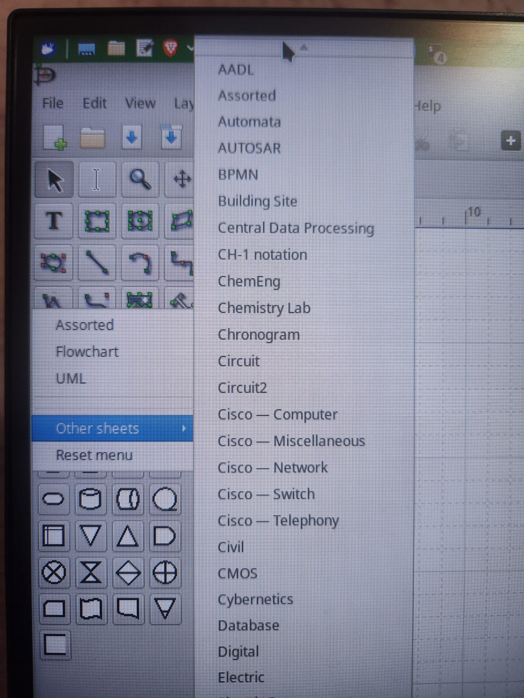
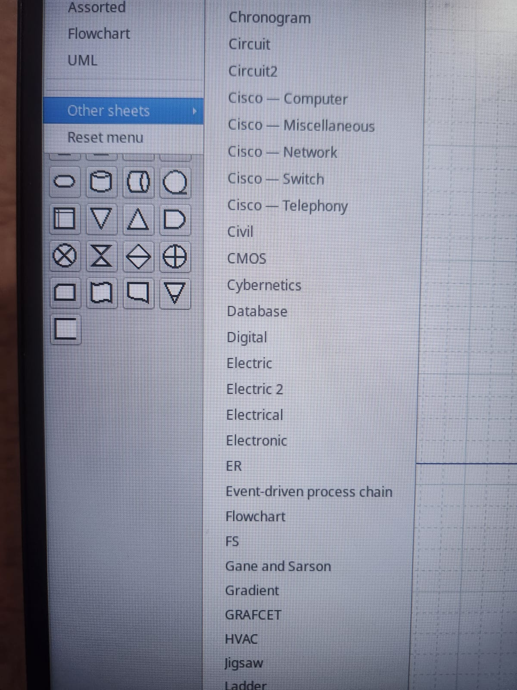
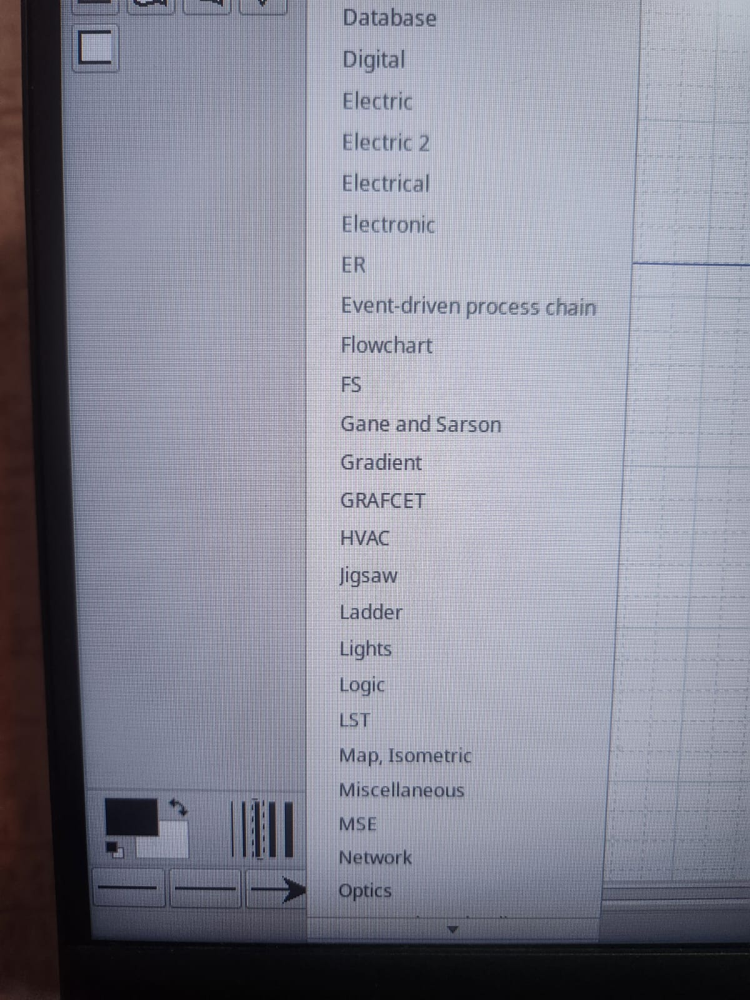
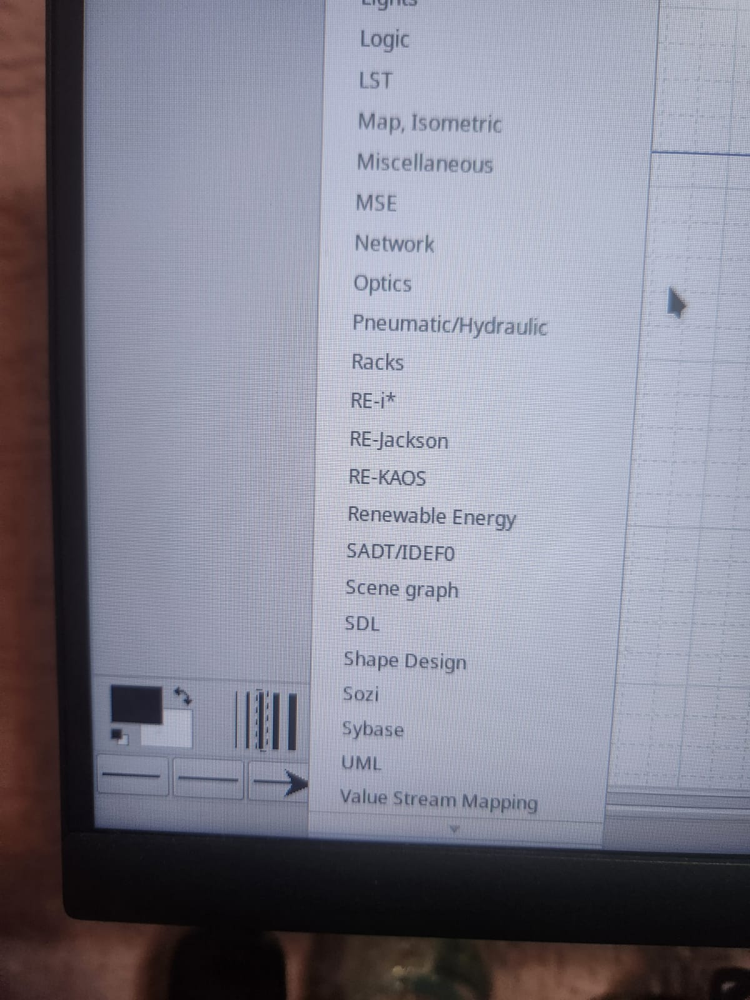

# Como configurar/instalar/usar o `dia diagram` no `Linux Ubuntu`

## Resumo

Neste documento estão contidos os principais comandos e configurações para configurar/instalar/usar o `dia diagram` no `Linux Ubuntu`.

## _Abstract_

_In this document are contained the main commands and settings to set up/install/use the `dia diagram` on `Linux Ubuntu`._


## Descrição [2]

### `dia diagram`

O `dia diagram` é um _software_ de código aberto de gerenciamento de calendário e agenda que oferece uma maneira eficaz de organizar compromissos, eventos, tarefas e lembretes em sistemas operacionais `Unix-like`, incluindo `Linux`. Com uma interface de usuário simples e intuitiva, o `dia diagram` permite que os usuários criem e visualizem calendários personalizados, adicionem eventos recorrentes ou únicos, definam prioridades e categorias para tarefas e mantenham um controle organizado de suas atividades diárias. Além disso, o `dia diagram` suporta a exportação de calendários em diversos formatos, facilitando a sincronização com outras ferramentas de gerenciamento de tempo e dispositivos. É uma escolha popular para quem busca uma solução leve e funcional de calendário para suas necessidades pessoais ou de trabalho.


## 1. Como configurar/instalar/usar o `dia diagram` no `Linux Ubuntu` [1]

Para configurar/instalar/usar o `dia diagram` no `Linux Ubuntu`, você pode seguir estas etapas:

1. Abra o `Terminal Emulator`. Você pode fazer isso pressionando:

    ```bash
    Ctrl + Alt + T
    ```


2. Certifique-se de que seu sistema esteja limpo e atualizado.

    2.1 Limpar o `cache` do gerenciador de pacotes `apt`. Especificamente, ele remove todos os arquivos de pacotes (`.deb`) baixados pelo `apt` e armazenados em `/var/cache/apt/archives/`. Digite o seguinte comando:
    
    ```bash
    sudo apt clean
    ``` 
    
    2.2 Remover pacotes `.deb` antigos ou duplicados do cache local. É útil para liberar espaço, pois remove apenas os pacotes que não podem mais ser baixados (ou seja, versões antigas de pacotes que foram atualizados). Digite o seguinte comando:
    
    ```bash
    sudo apt autoclean
    ```

    2.3 Remover pacotes que foram automaticamente instalados para satisfazer as dependências de outros pacotes e que não são mais necessários. Digite o seguinte comando:
    
    ```bash
    sudo apt autoremove -y
    ```

    2.4 Buscar as atualizações disponíveis para os pacotes que estão instalados em seu sistema. Digite o seguinte comando e pressione `Enter`: 
    
    ```bash
    sudo apt update
    ```

    2.5 **Corrigir pacotes quebrados**: Isso atualizará a lista de pacotes disponíveis e tentará corrigir pacotes quebrados ou com dependências ausentes:
    
    ```bash
    sudo apt --fix-broken install
    ```

    2.6 Limpar o `cache` do gerenciador de pacotes `apt`. Especificamente, ele remove todos os arquivos de pacotes (`.deb`) baixados pelo `apt` e armazenados em `/var/cache/apt/archives/`. Digite o seguinte comando:
    
    ```bash
    sudo apt clean
    ``` 
    
    2.7 Para ver a lista de pacotes a serem atualizados, digite o seguinte comando e pressione `Enter`:  
    
    ```bash
    sudo apt list --upgradable
    ```

    2.8 Realmente atualizar os pacotes instalados para as suas versões mais recentes, com base na última vez que você executou `sudo apt update`. Digite o seguinte comando e pressione `Enter`:
    
    ```bash
    sudo apt full-upgrade -y
    ```

1. **Instale o `dia diagram`:** Uma vez que os pacotes estejam atualizados, você pode instalar o `dia diagram` usando o gerenciador de pacotes apt. No terminal, digite:

    ```bash
    sudo apt install dia -y
    ```

2. **Confirmação e Uso:** Após a conclusão da instalação, você pode iniciar o `dia diagram` através do terminal com o comando `dia diagram` ou encontrá-lo no menu de aplicações do seu `Linux Ubuntu`.

Lembre-se de que, dependendo da sua versão do `Linux Ubuntu` e das configurações do sistema, esses passos podem variar um pouco. Se você encontrar problemas durante a instalação, verifique se o `dia diagram` é compatível com a sua versão do `Linux Ubuntu`.

## 2. Módulos de diagramas incluídos

A instalação padrão do Dia Diagram inclui folhas de formas para diferentes áreas e tipos de diagrama. A tabela reúne os módulos visíveis no menu **Other sheets** do aplicativo. As descrições indicam o uso principal de cada conjunto de formas.

| Módulo | Descrição |
|---|---|
| AADL | Modelagem arquitetural de sistemas embarcados e sistemas de tempo real. |
| Assorted | Formas variadas para diagramas genéricos. |
| Automata | Autômatos e máquinas de estados. |
| AUTOSAR | Arquiteturas e componentes de sistemas automotivos AUTOSAR. |
| BPMN | Processos de negócio usando a notação BPMN. |
| Building Site | Plantas e elementos de canteiros de obras. |
| Central Data Processing | Componentes de processamento centralizado de dados. |
| CH-1 notation | Símbolos da notação CH-1 para modelagem de processos. |
| ChemEng | Equipamentos e processos de engenharia química. |
| Chemistry Lab | Materiais e instrumentos de laboratório de química. |
| Chronogram | Diagramas temporais de sinais e eventos. |
| Circuit | Símbolos básicos de circuitos elétricos e eletrônicos. |
| Circuit2 | Símbolos adicionais para esquemas de circuitos. |
| Cisco — Computer | Equipamentos e componentes de informática da Cisco. |
| Cisco — Miscellaneous | Símbolos diversos de redes e produtos Cisco. |
| Cisco — Network | Equipamentos e topologias de rede Cisco. |
| Cisco — Switch | Switches e componentes relacionados da Cisco. |
| Cisco — Telephony | Equipamentos e sistemas de telefonia Cisco. |
| Civil | Elementos de engenharia civil e infraestrutura. |
| CMOS | Símbolos de circuitos e lógica CMOS. |
| Cybernetics | Elementos para diagramas de sistemas cibernéticos e controle. |
| Database | Entidades, relações e componentes de bancos de dados. |
| Digital | Portas e componentes de lógica digital. |
| Electric | Componentes e instalações elétricas. |
| Electric 2 | Símbolos elétricos adicionais. |
| Electrical | Componentes para esquemas de engenharia elétrica. |
| Electronic | Componentes para esquemas de eletrônica. |
| ER | Entidades e relacionamentos de modelos de dados. |
| Event-driven process chain | Processos modelados com cadeias de processos orientadas a eventos (EPC). |
| Flowchart | Símbolos de fluxogramas. |
| FS | Símbolos de sistemas de arquivos e estruturas relacionadas. |
| Gane and Sarson | Elementos para diagramas de fluxo de dados na notação Gane–Sarson. |
| Gradient | Formas e preenchimentos com gradiente. |
| GRAFCET | Etapas, transições e ações de controle sequencial GRAFCET. |
| HVAC | Equipamentos e sistemas de aquecimento, ventilação e ar-condicionado. |
| jigsaw | Peças de quebra-cabeça para composições e diagramas. |
| Ladder | Contatos, bobinas e elementos de lógica ladder. |
| Lights | Luminárias e elementos de iluminação. |
| Logic | Símbolos de lógica e operações booleanas. |
| LST | Símbolos para diagramas de linhas de transmissão. |
| Map, Isometric | Elementos de mapas e cenários isométricos. |
| Miscellaneous | Formas diversas sem categoria específica. |
| MSE | Símbolos para engenharia de sistemas mecânicos. |
| Network | Nós, conexões e componentes de redes. |
| Optics | Elementos e componentes de sistemas ópticos. |
| Pneumatic/Hydraulic | Válvulas, atuadores e componentes pneumáticos e hidráulicos. |
| Racks | Racks, gabinetes e equipamentos montados em rack. |
| RE-i* | Símbolos da notação de requisitos RE-i*. |
| RE-Jackson | Elementos de engenharia de requisitos segundo Jackson. |
| RE-KAOS | Objetivos, agentes e relações da metodologia KAOS. |
| Renewable Energy | Equipamentos e sistemas de energia renovável. |
| SADT/IDEF0 | Atividades, entradas, controles, saídas e mecanismos da notação IDEF0. |
| Scene graph | Nós e relações hierárquicas de grafos de cena. |
| SDL | Elementos da linguagem de especificação e descrição SDL. |
| Shape Design | Formas básicas para criação de desenhos e símbolos personalizados. |
| Sozi | Elementos para apresentações e diagramas compatíveis com Sozi. |
| Sybase | Componentes e notações associados ao Sybase. |
| UML | Classes, objetos, casos de uso e outros elementos UML. |
| Value Stream Mapping | Etapas, fluxos e informações de mapas de fluxo de valor. |

As capturas de tela da lista de módulos estão em [`docs/figures/modules`](docs/figures/modules/).

<div align="center">









</div>


### 2.1 Código completo para configurar/instalar/usar

Para configurar/instalar/usar o `dia diagram` no `Linux Ubuntu` sem precisar digitar linha por linha, você pode seguir estas etapas:

1. Abra o `Terminal Emulator`. Você pode fazer isso pressionando:

    ```bash
    Ctrl + Alt + T
    ```

2. Digite o seguinte comando e pressione `Enter`:

    ```bash
    sudo apt clean
    sudo apt autoclean
    sudo apt autoremove -y
    sudo apt update
    sudo apt --fix-broken install
    sudo apt clean
    sudo apt list --upgradable
    sudo apt full-upgrade -y
    sudo apt install dia -y
    dia
    ```


## 3. Código Red, Green e Blue (RGB) das cores

Segue as 10 cores mais claras com seus códigos RGB, ideais para uso em gráficos BPMN, para que o diagrama não fique muito escuro:

<div align="center">

| Cor                | Red | Green | Blue |
|--------------------|:---:|:-----:|:----:|
| **Azul Claro**     | 173 | 216   | 230  |
| **Verde Claro**    | 144 | 238   | 144  |
| **Rosa Claro**     | 255 | 182   | 193  |
| **Amarelo Claro**  | 255 | 255   | 224  |
| **Laranja Claro**  | 255 | 228   | 181  |
| **Lavanda (Roxo Claro)** | 230 | 230 | 250  |
| **Ciano Claro**    | 224 | 255   | 255  |
| **Verde Menta**    | 189 | 252   | 201  |
| **Pêssego**        | 255 | 218   | 185  |
| **Coral Claro**    | 240 | 128   | 128  |

</div>

Essas cores são mais suaves e garantirão que seu gráfico tenha uma aparência leve e agradável, evitando que fique muito escuro ou pesado.


## Referências

[1] OPENAI.
**Instalar `dia diagram` no `linux ubuntu` pelo `terminal emulator`.**
Disponível em: <https://chat.openai.com/c/d9a2f2cc-d4a0-47cd-97d8-c7bf452a833c> (texto adaptado).
ChatGPT.
Acessado em: 29/12/2023 10:01.

[2] OPENAI.
**Vs code: editor popular.**
Disponível em: <https://chat.openai.com/c/b640a25d-f8e3-4922-8a3b-ed74a2657e42> (texto adaptado).
ChatGPT.
Acessado em: 29/12/2023 10:01.

[3] OPENAI.
**Comandos de manutenção do ubuntu.**
Disponível em: <https://chat.openai.com/c/4a8cfaa2-30d6-474d-821f-7047a6a39830> (texto adaptado).
ChatGPT.
Acessado em: 29/12/2023 10:01.
